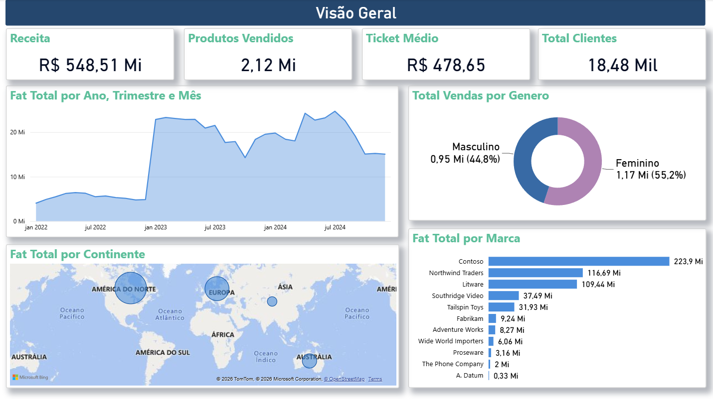
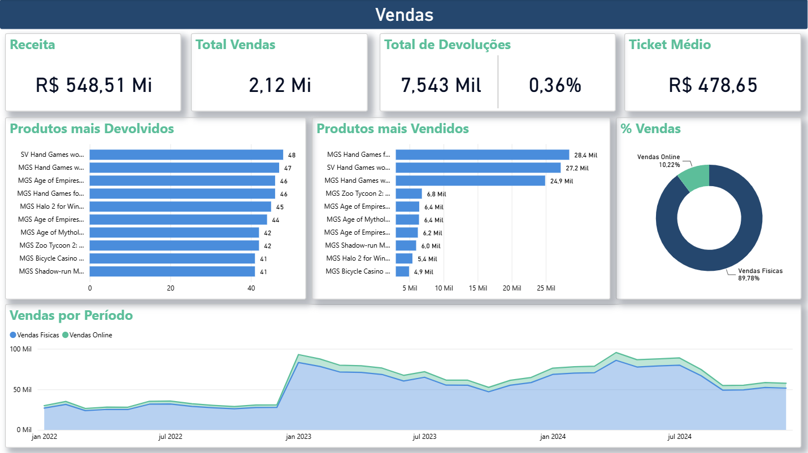
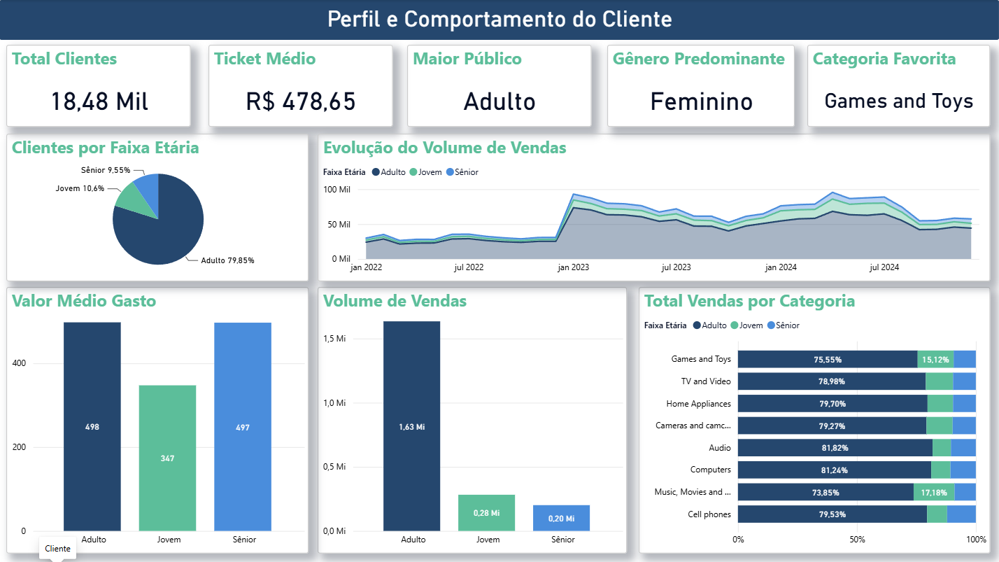
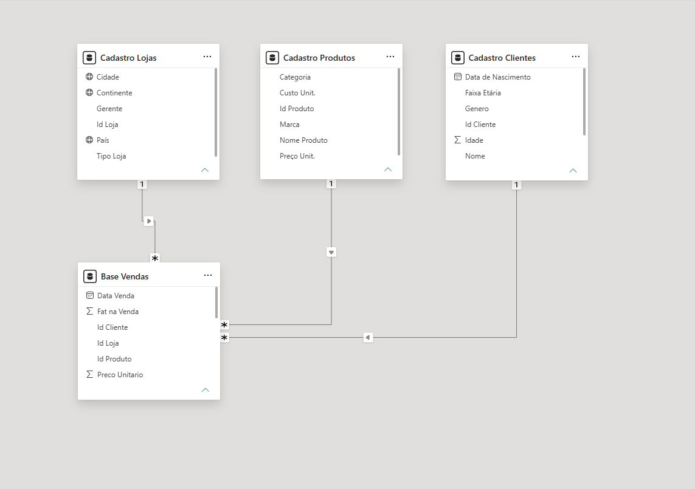

# dashboard-vendas-powerbi
Dashboard de vendas e perfil do cliente em Power BI

## 📌 Sobre o Projeto
Projeto em Power BI que analisa a performance comercial, o volume de vendas e o perfil dos clientes de uma operação de varejo. Os dados vêm de planilhas Excel, são tratados no Power Query, organizados em um modelo estrela (Star Schema) e analisados com medidas DAX, dividivos em três páginas de dashboard.

> **Fonte dos dados:** base pública disponibilizada no curso de Power BI da Hashtag Treinamentos, utilizada para fins de estudo e portfólio.

**Ferramentas:** Power BI Desktop · Power Query (linguagem M) · DAX

[Demonstração do dashboard](imagens/demo-dashboard.gif)

## 🔧 Tratamento de Dados (Power Query)

- **Vendas (2022, 2023 e 2024):** três planilhas anuais importadas e combinadas em uma única tabela `Base Vendas` com `Table.Combine`. Ajuste de tipos de dados, conversão do `Preco Unitario` (que vinha em centavos) dividindo por 100 e criação da coluna `Fat na Venda` (`Qtd. Vendida` × `Preco Unitario`).
- **Cadastro Lojas:** ajuste de cabeçalhos, remoção de coluna e linhas em branco, divisão da coluna `Localidade` pelo delimitador " - " em `País` e `Continente`, e união de nome e sobrenome em uma coluna `Gerente`.
- **Cadastro Clientes:** reorganização do nome (nome antes do sobrenome) na coluna `Nome`, padronização de `Genero` (F/M → Feminino/Masculino), cálculo da `Idade` a partir da `Data de Nascimento` e criação da `Faixa Etária` com coluna condicional (até 25 anos: Jovem; até 55: Adulto; acima: Sênior).
- **Cadastro Produtos:** ajuste de tipos e conversão de `Preço Unit.` e `Custo Unit.` de centavos para reais.

## ⚙️ Modelo de Dados
Modelo em esquema estrela, com relacionamentos 1:N entre as dimensões e a tabela fato:

- **Fato:** `Base Vendas` (`Id Cliente`, `Id Loja`, `Id Produto`, quantidades, preço e faturamento).
- **Dimensões:** `Cadastro Clientes`, `Cadastro Lojas` (`Continente`, `País`, `Cidade`, `Tipo Loja`) e `Cadastro Produtos` (`Categoria`, `Marca`).

## 🧮 Medidas DAX

| Medida | O que faz |
|---|---|
| `Fat Total` | Soma de `Fat na Venda` (faturamento) |
| `Total Vendas` | Soma da quantidade vendida |
| `Total Devoluções` / `% Devoluções` | Soma da quantidade devolvida e sua proporção sobre o total vendido, usando `DIVIDE` para evitar divisão por zero |
| `Ticket Médio` | Média do faturamento por venda (`AVERAGE`) |
| `Qtd Clientes` | Contagem distinta de clientes (`DISTINCTCOUNT`) |
| `Vendas Online` | Quantidade vendida filtrada por `Tipo Loja = "Online"` (`CALCULATE`) |
| `Vendas Fisicas` | `Total Vendas` menos `Vendas Online` |
| `% Vendas Online` / `% Vendas Fisicas` | Participação de cada canal na quantidade vendida |
| `Categoria Favorita` e `Maior Público` | Categoria e faixa etária com maior volume de vendas, usando `TOPN` dentro do `CALCULATE` |
| `Ordem Idade` | Coluna calculada com `SWITCH` para ordenar a faixa etária |

## 📈 Páginas do Dashboard

1. **Visão Geral:** receita de R$ 548,51 Mi, evolução mensal, faturamento por continente e por marca, e vendas por gênero.
2. **Vendas:** quantidade vendida, total de devoluções, produtos mais vendidos e devolvidos e proporção entre vendas físicas e online.
3. **Perfil e Comportamento do Cliente:** distribuição por faixa etária, valor médio gasto, volume de vendas e categorias por público.

## 🎨 Visualização

- Formatação manual dos visuais, com paleta padronizada em tons de azul e verde.
- Cartões com valores abreviados (Mi/Mil) e ajuste das casas decimais nos eixos.

## 🖼️ Telas do Projeto

### Visão Geral

### Dashboard de Vendas

### Perfil e Comportamento do Cliente

### Modelo de Dados

